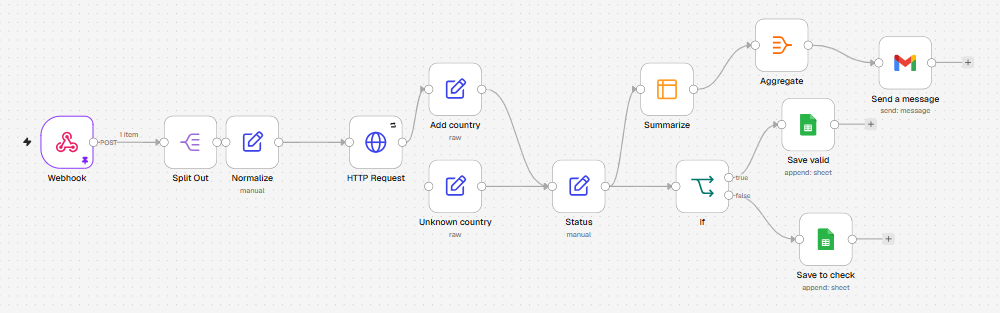
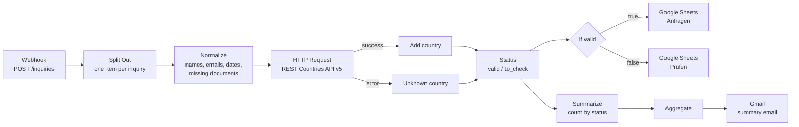
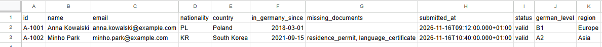
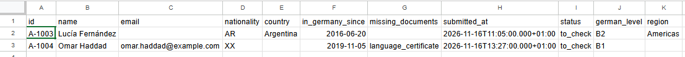
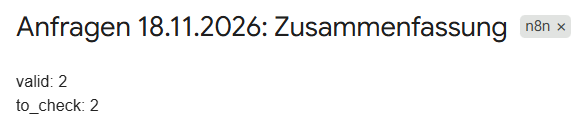
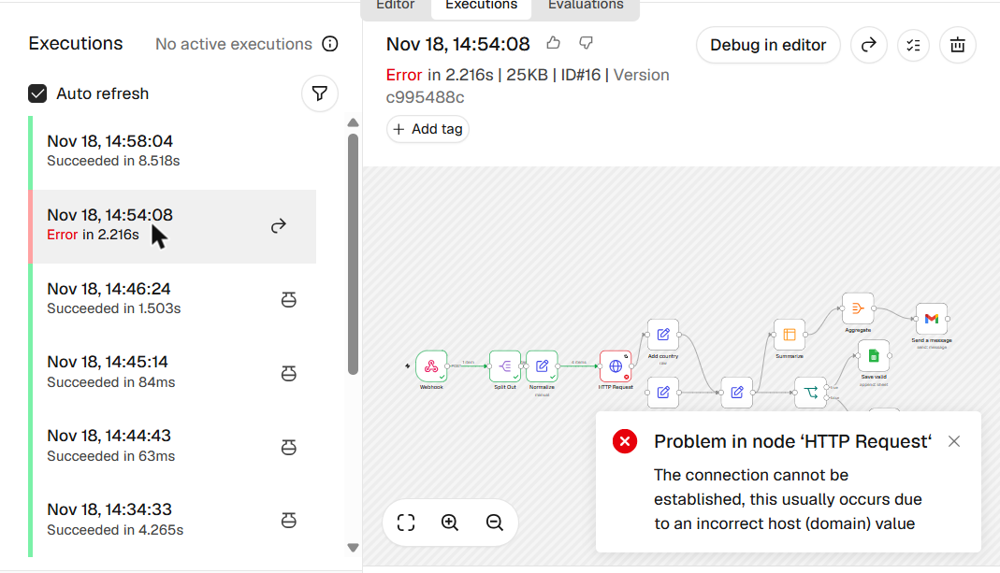
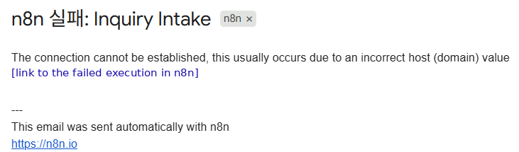
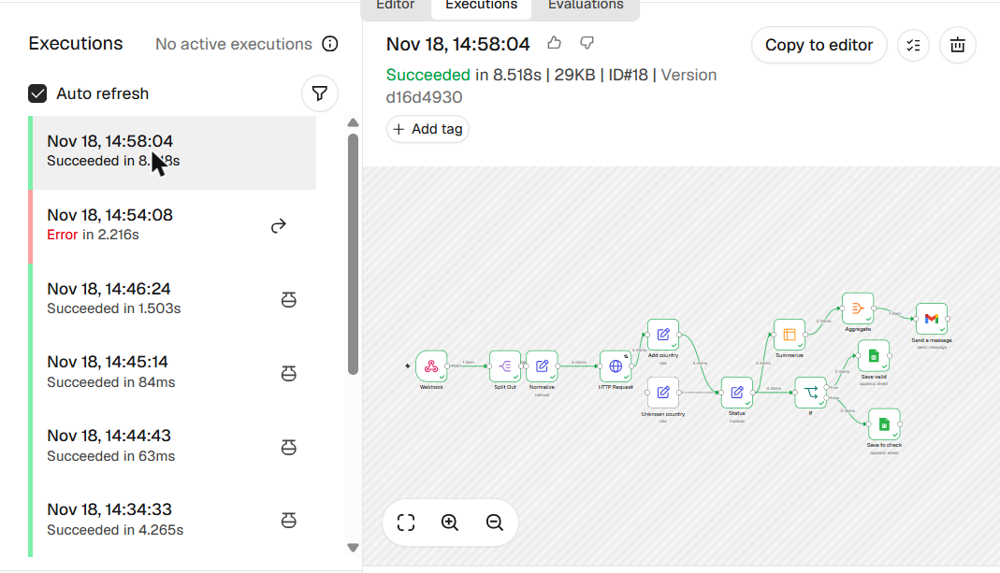

# Inquiry Intake Automation with n8n

An n8n workflow that takes incoming client inquiries, cleans and enriches the data, sorts each inquiry into **valid** or **to check**, stores the results in Google Sheets, sends a summary email for each batch, and alerts me when a run fails.

The scenario is modelled on the intake process of a legal-tech service that helps people with their naturalisation application. **All data in this repository is fictional.** The workflow does not assess legal eligibility; it only checks data quality and missing documents.



## What it does



A separate **Error Alert** workflow (Error Trigger → Gmail) is set as the error workflow and sends a notification whenever a production run fails.

| Step | Node | What happens |
|---|---|---|
| Trigger | Webhook | Receives a batch of inquiries as JSON |
| Iterate | Split Out | Turns the `inquiries` array into one item per inquiry |
| Transform | Edit Fields (Normalize) | Trims and capitalises names, lower-cases emails, converts `dd.MM.yyyy` dates to ISO 8601 (Europe/Berlin), lists missing documents |
| Enrich | HTTP Request | Looks up the country name and region by ISO code (Bearer-token auth, retry on fail, separate error output) |
| Merge | Edit Fields (Add / Unknown country) | Combines the normalised inquiry with the API result |
| Condition | Edit Fields (Status) + If | `valid` if the email is well-formed and the country is known, otherwise `to_check` |
| Store | Google Sheets | Appends valid inquiries to `Anfragen`, the rest to `Prüfen` |
| Aggregate | Summarize + Aggregate | Counts inquiries per status and builds one summary item |
| Notify | Gmail | Sends the summary for the batch |
| Monitor | Error workflow | Error Trigger → Gmail alert with the error message and a link to the failed execution |

## Example

Input (`sample-payload.json`, shortened):

```json
{ "id": "A-1001", "name": "  anna  KOWALSKI ", "email": " Anna.Kowalski@Example.com ",
  "nationality": "PL", "in_germany_since": "01.03.2018",
  "documents": { "passport": true, "residence_permit": true, "language_certificate": true } }
```

After the workflow:

```json
{ "id": "A-1001", "name": "Anna Kowalski", "email": "anna.kowalski@example.com",
  "nationality": "PL", "country": "Poland", "region": "Europe",
  "in_germany_since": "2018-03-01", "missing_documents": "", "status": "valid" }
```

The sample contains four inquiries on purpose: two valid ones, one without an email address and one with an unknown country code (`XX`).

Valid inquiries (`Anfragen`):



Inquiries to check (`Prüfen`):



Summary email:



## Error handling

- **Retry on fail:** the HTTP Request retries 3 times with a 1-second pause.
- **Error output:** if the API call fails for one inquiry, that inquiry goes to a separate branch instead of stopping the whole run.
- **Defensive mapping:** an unknown country code returns `200` with an empty result, so the mapping falls back to an empty country and the inquiry is marked `to_check`.
- **Alerting:** if a production run fails, the Error Alert workflow sends an email with the error message and a link to the execution.

I tested the alert by pointing the HTTP Request at an invalid host. The run stopped at the HTTP Request node:



and the Error Alert workflow sent this email:



After restoring the correct host, the next run succeeded. Both runs are visible in the execution history:



## Run it yourself

1. Start n8n, either on [n8n Cloud](https://n8n.io) or locally with Docker:
   ```bash
   docker compose up -d   # then open http://localhost:5678
   ```
2. Import `workflow.json` and `error-workflow.json` (Workflow menu → Import from file).
3. Create the credentials:
   - **Header Auth** for the REST Countries API v5: name `Authorization`, value `Bearer <your API key>` (free key at restcountries.com)
   - **Google Sheets OAuth2** and **Gmail OAuth2**
4. Create a Google Sheet with two tabs, `Anfragen` and `Prüfen`, and this header row in both:
   `id, name, email, nationality, country, in_germany_since, missing_documents, submitted_at, status, german_level, region`
5. In both Google Sheets nodes, select your sheet (the export uses the placeholder `YOUR_GOOGLE_SHEET_ID`). In both Gmail nodes, replace `you@example.com` with your address.
6. In the Inquiry Intake settings, set **Error Workflow** to `Error Alert` and publish both workflows.
7. Send the sample data to the webhook, for example with PowerShell (`test-request.ps1`) or curl:
   ```bash
   curl -X POST https://<your-n8n>/webhook/inquiries \
     -H "Content-Type: application/json" --data-binary @sample-payload.json
   ```

Credentials are not part of the exported files.

## What I learned

- **API migration mid-build:** REST Countries v3.1 was deprecated while I was building this. I read the migration docs and switched to v5, which needs Bearer-token authentication and returns a different response structure.
- **Documentation vs. reality:** the docs say an unknown code returns `404`, but in my tests it returned `200` with an empty list. I handle both cases.
- **Testing triggers:** pinning the webhook data made it possible to test each node without resending the request, and the Error Trigger only fires on production executions, not on manual test runs.

## Background

I worked for over four years as a developer of manufacturing systems (MES) in tire and pharmaceutical production, where I built interfaces between MES, SAP and production equipment and automated error-prone manual steps. This project applies the same approach (trigger, condition, action, monitoring) with n8n.

## Files

| File | Purpose |
|---|---|
| `workflow.json` | Main workflow (Inquiry Intake) |
| `error-workflow.json` | Error Alert workflow |
| `sample-payload.json` | Four fictional inquiries for testing |
| `test-request.ps1` | Sends the sample data to the webhook (PowerShell) |
| `docker-compose.yml` | Runs n8n locally |
| `screenshots/` | Screenshots of the workflow, results and alerts |
